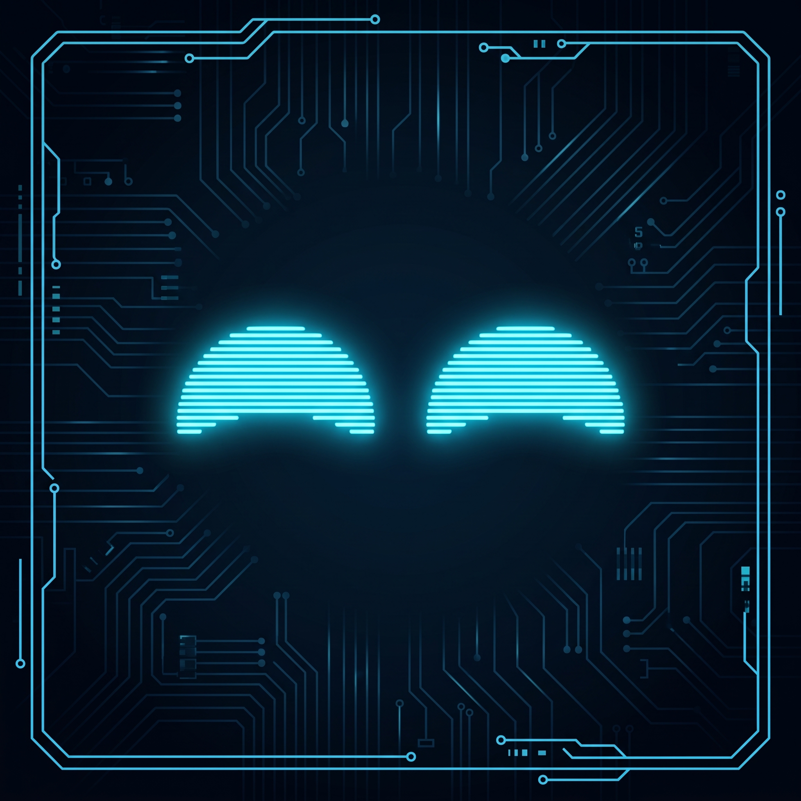

<h1 align="center"> 
  🤖 NUTR-E (NutriBot)
</h1>

  
  
  

  

> **Resumo:** Um simpático e interativo robô assistente de mesa projetado para o escritório. Ele une hardware e software para auxiliar na organização diária, gestão de agendas, controle de hábitos e emissão de lembretes, tornando o ambiente de trabalho mais produtivo e tecnológico.

---

## 🎯 **Principais Funcionalidades**

*   📅 **Gestão de Agenda e Organização:** Lembretes automáticos sobre horários marcados e tarefas do escritório.
*   🔔 **Alertas de Hábitos (Lembretes):** Avisos visuais e sonoros programáveis (ex: hora de beber água, hora de se alimentar).
*   📱 **Painel de Controle Web (PWA):** Interface amigável para configurar horários, alertas e interagir com o robô de forma remota.
*   👀 **Interação Procedural:** Olhinhos animados renderizados no display OLED, garantindo "personalidade" e feedback visual imediato.
*   ⌨️ **Interação Tátil:** Botões com switches mecânicos de teclado para confirmar tarefas ou silenciar alarmes com um clique satisfatório.

---

## 💻 **Tecnologias Utilizadas**

O projeto integra microeletrônica com desenvolvimento web para entregar a melhor experiência:

*   **Hardware / Microeletrônica:** `ESP32` | `C++ (Arduino IDE)`
*   **Interface Física:** Display `OLED 0.96" SSD1306` | Switches Mecânicos

---

## ⚙️ **Pré-requisitos**

Para replicar, testar ou compilar o código deste projeto, você precisará de:

*   [**Arduino IDE**](https://www.arduino.cc/en/software).
*   Bibliotecas (`Adafruit_SSD1306`, `Async TCP`, `ESP Async WebServer`, `QRCode`).

---

## 🚀 **Instalação e Execução**

**1. Configurando o Hardware (ESP32):**
*   Abra o arquivo `.ino` na Arduino IDE.
*   Certifique-se de instalar as bibliotecas necessárias.
*   Selecione sua placa ESP32 e a porta COM correspondente, depois clique em "Carregar".

## 📸 **Telas do Painel (Screenshots)**

> *Confira abaixo a interface do Painel WEB utilizado para gerenciar e configurar o NUTR-E.*

  
  
  
  
  

